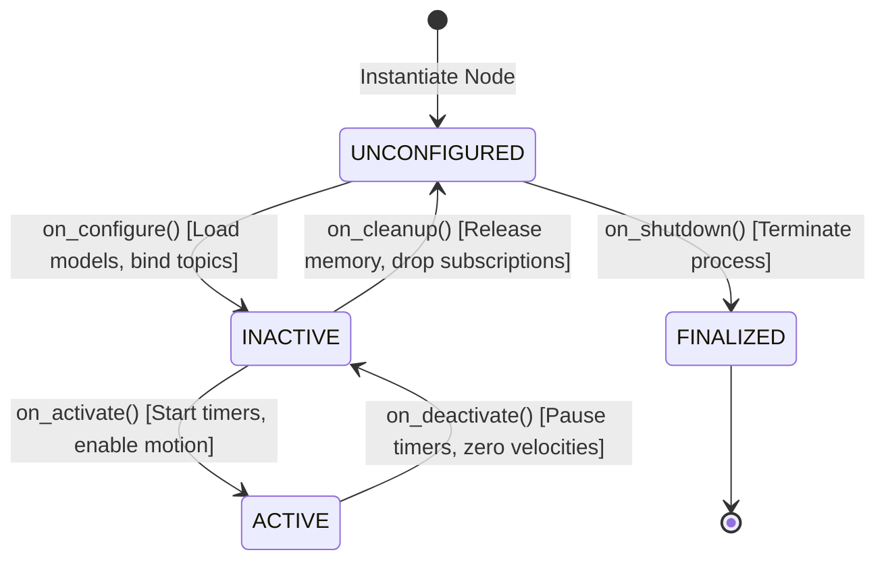

# Project ARIA: Agents & Manipulation Skills Library

## 1. ROS 2 Lifecycle Management of Agents

Some agents inherit from `rclpy.lifecycle.LifecycleNode`; others, including the health monitor, are ordinary ROS nodes. Launch starts agents on timers and then runs a best-effort lifecycle activator. The activator skips unavailable nodes, so its completion message does not prove that every agent started successfully.

There is no shared agent-heartbeat watchdog or automatic process-replacement protocol in the current runtime. Lifecycle services can configure or activate a node, but do not restart a crashed process.

---

## 2. Current Skill Execution Status

The planner vocabulary is broader than the current executor. The table describes actual execution behavior; listed but unsupported skills now fail explicitly rather than reporting success without acting.

| Skill | Current status |
| :--- | :--- |
| **`pick`** | Implemented as an IK approach/descent and simulator gripper attachment. Lift and grasp success are not equivalent to verified task placement. |
| **`place`** | Moves to a located destination and releases. The executor does not independently verify that the object ended inside the receptacle. |
| **`transport`** | Moves a verified held object above a located destination; requires a destination pose. |
| **`sort`** | Composite locate/pick/release path; physical containment is not verified by the executor. |
| **`press`** | Contact-sensor and retract gate in simulation; it does not verify an electrical or logical button state. |
| **`inspect`** | Captures wrist-camera views and computes image focus/edge statistics; it does not perform the advertised full inspection/classification. |
| **`push`, `pull`, `slide`, `roll`, `sweep`** | Not implemented as guarded manipulation controllers; execution returns failure. |
| **`sam`, `depth`, `cleargrasp`, `material`** | Not integrated into grasp-pose refinement or verified material/depth estimation; unsupported requests return failure (ClearGrasp is skipped only for an opaque target). |
| **`verify_stable`** | Stable stacking is not currently verified by available sensor evidence and returns failure. |

---

## 3. In-Hand Manipulation Protocol

Implemented in [`arm_agents/arm_agents/in_hand_manipulation.py`](file:///home/gaminizer/Projects/ARIA/arm_agents/arm_agents/in_hand_manipulation.py):

Allows reorienting elongated tools (screwdrivers, paintbrushes, cylindrical pens) without releasing the object:
1. **Grip Relaxation:** Gripper servo decreases clamping effort from $100\%$ to $45\%$, transitioning the contact patch from sticking friction to controlled slipping friction.
2. **Wrist Pivot:** The wrist roll and pitch joints execute a coordinated micro-motion against an external reaction surface (the optical table rim or a fixture guide).
3. **Re-Grip Confirmation:** Gripper servo returns to $100\%$ effort. The end-effector MPU6050 verifies that the tool's gravitational orientation has shifted to the target angle.

---

## 4. Search Behavior & Obstacle Scanning

Implemented in [`arm_planner/arm_planner/search_behavior.py`](file:///home/gaminizer/Projects/ARIA/arm_planner/arm_planner/search_behavior.py):

When an object requested in a command cannot be located by the overhead camera:
1. **Workspace Boundary Sweep:** The arm shifts to three elevated scanning waypoints (Left, Center, Right) at $Z = 0.25\,\text{m}$.
2. **Peeking Behind Obstacles:** If tall obstacles (e.g., storage towers or bins) are present in the semantic map, the wrist camera approaches the rear occlusion zones at an oblique $45^\circ$ angle.
3. **World Model Query & User Escalation:** If the workpiece remains undetected after systematic scanning:
   - Queries historical coordinate logs in `world_model.db`.
   - Triggers `DialogueAgent` to ask the user: *"I checked the workspace and behind the storage tower, but cannot find the blue bolt. Has it been moved?"*

---

## 5. Cable-Aware Motion Planning

Because low-cost manipulators utilize external wiring harnesses routed along the links:
- Joint 1 travel is limited to $[-\pi/2, +\pi/2]$ to prevent cable wrap around the base pedestal.
- Continuous wrist spinning is prohibited; roll maneuvers are constrained to $[-\pi/2, +\pi/2]$.
- Intermediate Cartesian waypoints maintain link configurations that prevent harness tension spikes ($< 15\,\text{mm}$ link-to-link excursion).
